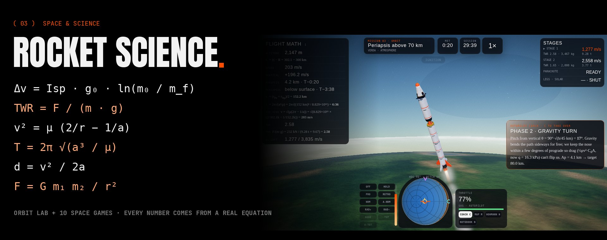

<div align="center">

[](https://normansrule.github.io/pixel-arcade/)

# PIXEL ARCADE.

### 486 original games · 31 full-3D worlds · a 2D + 3D game builder · zero installs

[](https://normansrule.github.io/pixel-arcade/)
[](https://github.com/Normansrule/pixel-arcade/releases)
[](https://normansrule.github.io/pixel-arcade/builder/)


[](https://github.com/Normansrule/pixel-arcade/actions/workflows/test.yml)


**[Play](#-play-in-10-seconds)** · **[3D worlds](#-31-full-3d-worlds)** · **[Cabinets](#-455-arcade-cabinets)** · **[Space](#-rocket-science-for-real)** · **[Builder](#-build-your-own)** · **[Get the app](#-play-anywhere)** · **[All games](#-every-game)**


</div>

---

## ⚡ Play in 10 seconds

1. Open **[normansrule.github.io/pixel-arcade](https://normansrule.github.io/pixel-arcade/)**.
2. Click a cabinet. Press **Space**.
3. Beat the clock. Every game runs against a **round timer**, and the last 10 seconds count down on screen. VS games are decided on points when time runs out.

| | Keyboard | Mouse / touch |
|---|---|---|
| Move | Arrows / WASD | aim games follow the pointer · on-screen D-pad on phones |
| A: fire, jump, select | Space | click, hold, or spam-click |
| B | X | right-click |
| Pause · Restart · Mute · Graphics | P · R · M · G | |
| Exit | Esc | |
| 2 players | P1 WASD + F/G · P2 Arrows + Enter/Shift | |

Can't decide? Hit 🎲 in the top bar. Star ★ the ones you love; they live under **Favorites**.

## 🌍 31 full-3D worlds

Real-time 3D in the browser: shadows, ambient occlusion, bloom, filmic colour, and **G** to switch quality. Every one is an **original game** inspired by a classic (search the hub for the inspiration's name: *gta*, *call of duty*, *tarkov*, *minecraft*, *mario kart*…).

**New:** an open-world city, round-based zombie survival, an extraction shooter, tank battles, air dogfights, a jetpack arena shooter, castle archery CTF, sniper missions, drift racing and a parkour speedrunner — plus big overhauls of Voxel Frontier, Abyss Diver, Frontline Ops, Strike Zone, Starship Suspects, Platform Brawl and Critter Kart.


<table>
<tr>
<td width="33%" align="center"><a href="https://normansrule.github.io/pixel-arcade/city/"></a><br><b>Neon Bay</b><br><sub>GTA-style</sub></td>
<td width="33%" align="center"><a href="https://normansrule.github.io/pixel-arcade/zombies/"></a><br><b>Nightfall</b><br><sub>CoD Zombies-style</sub></td>
<td width="33%" align="center"><a href="https://normansrule.github.io/pixel-arcade/extract/"></a><br><b>Exfil</b><br><sub>Escape from Tarkov-style</sub></td>
</tr>
<tr>
<td width="33%" align="center"><a href="https://normansrule.github.io/pixel-arcade/tanks/"></a><br><b>Ironclad</b><br><sub>World of Tanks-style</sub></td>
<td width="33%" align="center"><a href="https://normansrule.github.io/pixel-arcade/sky/"></a><br><b>Sky Lancers</b><br><sub>War Thunder-style</sub></td>
<td width="33%" align="center"><a href="https://normansrule.github.io/pixel-arcade/arena/"></a><br><b>Nova Arena</b><br><sub>Halo-style</sub></td>
</tr>
<tr>
<td width="33%" align="center"><a href="https://normansrule.github.io/pixel-arcade/bow/"></a><br><b>Longbow Keep</b><br><sub>Narrow One-style</sub></td>
<td width="33%" align="center"><a href="https://normansrule.github.io/pixel-arcade/scope/"></a><br><b>Long Shot</b><br><sub>Sniper Elite-style</sub></td>
<td width="33%" align="center"><a href="https://normansrule.github.io/pixel-arcade/drift/"></a><br><b>Sideways</b><br><sub>Drift Hunters-style</sub></td>
</tr>
<tr>
<td width="33%" align="center"><a href="https://normansrule.github.io/pixel-arcade/parkour/"></a><br><b>Runline</b><br><sub>Mirror's Edge-style</sub></td>
<td width="33%" align="center"><a href="https://normansrule.github.io/pixel-arcade/strike/"></a><br><b>Strike Zone</b><br><sub>Krunker-style</sub></td>
<td width="33%" align="center"><a href="https://normansrule.github.io/pixel-arcade/voxel/"></a><br><b>Voxel Frontier</b><br><sub>Minecraft-style</sub></td>
</tr>
<tr>
<td width="33%" align="center"><a href="https://normansrule.github.io/pixel-arcade/abyss/"></a><br><b>Abyss Diver</b><br><sub>Subnautica-style</sub></td>
<td width="33%" align="center"><a href="https://normansrule.github.io/pixel-arcade/frontline/"></a><br><b>Frontline Ops</b><br><sub>Call of Duty-style</sub></td>
<td width="33%" align="center"><a href="https://normansrule.github.io/pixel-arcade/monsters/"></a><br><b>Block Beasts</b><br><sub>Pokémon / Pixelmon-style</sub></td>
</tr>
<tr>
<td width="33%" align="center"><a href="https://normansrule.github.io/pixel-arcade/gp/"></a><br><b>Kart Grand Prix</b><br><sub>Mario Kart-style</sub></td>
<td width="33%" align="center"><a href="https://normansrule.github.io/pixel-arcade/rocket/"></a><br><b>Rocket Arena</b><br><sub>Rocket League-style</sub></td>
<td width="33%" align="center"><a href="https://normansrule.github.io/pixel-arcade/breach/"></a><br><b>Breach Point</b><br><sub>CS:GO-style</sub></td>
</tr>
<tr>
<td width="33%" align="center"><a href="https://normansrule.github.io/pixel-arcade/siege/"></a><br><b>Fortress Breach</b><br><sub>Rainbow Six Siege-style</sub></td>
<td width="33%" align="center"><a href="https://normansrule.github.io/pixel-arcade/orbit/"></a><br><b>Orbit Lab</b><br><sub>Kerbal Space Program-style</sub></td>
<td width="33%" align="center"><a href="https://normansrule.github.io/pixel-arcade/quest/"></a><br><b>Wild Quest</b><br><sub>Zelda: BotW-style</sub></td>
</tr>
<tr>
<td width="33%" align="center"><a href="https://normansrule.github.io/pixel-arcade/plaza/"></a><br><b>Penguin Plaza</b><br><sub>Club Penguin-style</sub></td>
<td width="33%" align="center"><a href="https://normansrule.github.io/pixel-arcade/royale/"></a><br><b>Storm Royale</b><br><sub>Fortnite-style</sub></td>
<td width="33%" align="center"><a href="https://normansrule.github.io/pixel-arcade/tumble/"></a><br><b>Tumble Royale</b><br><sub>Fall Guys-style</sub></td>
</tr>
<tr>
<td width="33%" align="center"><a href="https://normansrule.github.io/pixel-arcade/brawl/"></a><br><b>Platform Brawl</b><br><sub>Smash Bros-style</sub></td>
<td width="33%" align="center"><a href="https://normansrule.github.io/pixel-arcade/striker/"></a><br><b>Striker 11</b><br><sub>FIFA-style</sub></td>
<td width="33%" align="center"><a href="https://normansrule.github.io/pixel-arcade/skate/"></a><br><b>Skate City</b><br><sub>Tony Hawk-style</sub></td>
</tr>
<tr>
<td width="33%" align="center"><a href="https://normansrule.github.io/pixel-arcade/suspects/"></a><br><b>Starship Suspects</b><br><sub>Among Us-style</sub></td>
<td width="33%" align="center"><a href="https://normansrule.github.io/pixel-arcade/drive/"></a><br><b>Night Drive</b><br><sub>Crazy Taxi-style</sub></td>
<td width="33%" align="center"><a href="https://normansrule.github.io/pixel-arcade/kart/"></a><br><b>Critter Kart</b><br><sub>Diddy Kong Racing-style</sub></td>
</tr>
<tr>
<td width="33%" align="center"><a href="https://normansrule.github.io/pixel-arcade/pets/"></a><br><b>Pet Brawl</b><br><sub>Super Auto Pets-style</sub></td>
</tr>
</table>

## 🕹️ 455 arcade cabinets


Classic arcade, sports, board games with real CPU search, puzzles, cards, party games and sims, all drawn in HD with particles, shake and juice. VS CPU at three difficulties, or grab a friend for 2-player.

         

Recent additions: falling-block battle royale (Tetris 99-style), lane card battler (Clash Royale-style), farming life (Stardew-style), roguelite poker (Balatro-style), creature RPG (Pokémon-style), cooking chaos (Overcooked-style), Hades-style dungeon runs and plenty more.

## 🚀 Rocket science, for real



**[Orbit Lab](https://normansrule.github.io/pixel-arcade/orbit/)** is a friendly Kerbal-style rocket game where the maths is on screen. Build a rocket and watch **Tsiolkovsky** tell you its Δv, then fly real two-body orbits with patched conics to the moon. Use the **Hohmann helper** to see each transfer burn worked out with your numbers. An autopilot coach flies along and explains the gravity turn, and a Math Notebook collects every formula you've used.

Ten more space games teach a physics idea each: gravity slingshots (F = Gm₁m₂/r²), docking (t = d/v), transfer windows, landers on eight worlds (d = v²/2a), satellite constellations (Kepler's 3rd law), solar sails, asteroid deflection, launch control, relativistic star navigation (γ) and Δv-budget cargo runs.

## 🛠️ Build your own


The **[Game Builder](https://normansrule.github.io/pixel-arcade/builder/)** is a Unity-style editor that runs in your browser, in **2D or 3D**.

- **Start from a template:** platformer, top-down adventure, shooter or maze in 2D; obstacle course, coin island, maze run or arena survival in 3D.
- **Build the scene:** drag in players, enemies, coins, hazards, keys, doors, springs and lights. Move, rotate and scale them with W/E/R gizmos.
- **Add behaviour:** give objects components (patrol, chase, shooter, collectible, hazard…) and wire **WHEN → DO** rules without code.
- **Draw your own art** in a 16×16 sprite painter.
- **Ship it:** press **Play** to test, share a link that opens straight into your game, or **publish** it to the arcade.

## 📲 Play anywhere


| Where | How |
|---|---|
| **Browser** | [normansrule.github.io/pixel-arcade](https://normansrule.github.io/pixel-arcade/): nothing to install. |
| **Install as an app** | Click **⤓ APP** in the top bar (Chrome/Edge/Android), or *Share → Add to Home Screen* on iPhone/iPad. Opens full-screen with its own icon. |
| **Offline** | Click **⤓ Save all offline** at the bottom of the hub; every game is cached and the arcade runs with no internet. |
| **Desktop app** | Installers for **Windows, macOS and Linux** on the [Releases](https://github.com/Normansrule/pixel-arcade/releases) page, built automatically by GitHub Actions. |
| **One file** | `python3 build.py` → `dist/pixel-arcade.html`, the canvas arcade in a single file. |

## 🏆 Scores on GitHub

Click the profile chip and enter your GitHub username. At game over, **U** posts your score as a GitHub issue and **L** opens the global top 10. The 3D worlds have a **POST SCORE** button on their results screens.

## 📜 Every game

<details><summary><b>Action</b> · 56</summary>

| Game | Mode | |
|---|---|---|
| [Abyss Diver](https://normansrule.github.io/pixel-arcade/abyss/) | full 3D | [src](abyss/game.js) |
| [Archer Tower](https://normansrule.github.io/pixel-arcade/#archertower) | solo | [src](games/action3.js) |
| [Asteroid Deflect](https://normansrule.github.io/pixel-arcade/#asteroiddefense) | solo | [src](games/space1.js) |
| [Beat Jumper](https://normansrule.github.io/pixel-arcade/#beatjumper) | solo | [src](games/action3.js) |
| [Boomerang](https://normansrule.github.io/pixel-arcade/#boomerang) | solo | [src](games/action3.js) |
| [Boss Rush](https://normansrule.github.io/pixel-arcade/#bossrush) | solo | [src](games/action2.js) |
| [Breach Point](https://normansrule.github.io/pixel-arcade/breach/) | full 3D | [src](breach/game.js) |
| [Broadside](https://normansrule.github.io/pixel-arcade/#broadside) | solo | [src](games/action3.js) |
| [Bullet Hell](https://normansrule.github.io/pixel-arcade/#bullethell) | solo | [src](games/action3.js) |
| [Castle Defense](https://normansrule.github.io/pixel-arcade/#castletd) | solo | [src](games/popular2.js) |
| [Cavern Quest](https://normansrule.github.io/pixel-arcade/#cavernquest) | solo | [src](games/advanced1.js) |
| [Cell Grow](https://normansrule.github.io/pixel-arcade/#cellgrow) | solo | [src](games/action3.js) |
| [Chopper Rescue](https://normansrule.github.io/pixel-arcade/#chopper) | solo | [src](games/action2.js) |
| [Dash Peak](https://normansrule.github.io/pixel-arcade/#dashpeak) | solo | [src](games/action3.js) |
| [Depth Charge](https://normansrule.github.io/pixel-arcade/#depth) | solo | [src](games/action2.js) |
| [Dungeon Brawl](https://normansrule.github.io/pixel-arcade/#brawl) | solo | [src](games/action.js) |
| [Exfil](https://normansrule.github.io/pixel-arcade/extract/) | full 3D | [src](extract/game.js) |
| [Fortress Breach](https://normansrule.github.io/pixel-arcade/siege/) | full 3D | [src](siege/game.js) |
| [Frontline Ops](https://normansrule.github.io/pixel-arcade/frontline/) | full 3D | [src](frontline/game.js) |
| [Grapple Hook](https://normansrule.github.io/pixel-arcade/#grapple) | solo | [src](games/action3.js) |
| [Gun Dungeon](https://normansrule.github.io/pixel-arcade/#gundungeon) | solo | [src](games/action3.js) |
| [Hero Quest](https://normansrule.github.io/pixel-arcade/#heroquest) | solo | [src](games/advanced1.js) |
| [Horde Survivor](https://normansrule.github.io/pixel-arcade/#survivors) | solo | [src](games/action3.js) |
| [Ironclad](https://normansrule.github.io/pixel-arcade/tanks/) | full 3D | [src](tanks/game.js) |
| [Lander Pro](https://normansrule.github.io/pixel-arcade/#landerpro) | solo | [src](games/space1.js) |
| [Lane Defense](https://normansrule.github.io/pixel-arcade/#lanedefense) | solo | [src](games/advanced1.js) |
| [Last Bot Standing](https://normansrule.github.io/pixel-arcade/#royale) | solo | [src](games/action.js) |
| [Lava Rise](https://normansrule.github.io/pixel-arcade/#lavarise) | solo | [src](games/action3.js) |
| [Long Shot](https://normansrule.github.io/pixel-arcade/scope/) | full 3D | [src](scope/game.js) |
| [Longbow Keep](https://normansrule.github.io/pixel-arcade/bow/) | full 3D | [src](bow/game.js) |
| [Maze Bots](https://normansrule.github.io/pixel-arcade/#mazebots) | solo | [src](games/retro5.js) |
| [Neon Bay](https://normansrule.github.io/pixel-arcade/city/) | full 3D | [src](city/game.js) |
| [Neon Fighters](https://normansrule.github.io/pixel-arcade/#fighters) | vs CPU · 2P | [src](games/action.js) |
| [Neon Hit](https://normansrule.github.io/pixel-arcade/#neonhit) | solo | [src](games/action3.js) |
| [Nightfall](https://normansrule.github.io/pixel-arcade/zombies/) | full 3D | [src](zombies/game.js) |
| [Nova Arena](https://normansrule.github.io/pixel-arcade/arena/) | full 3D | [src](arena/game.js) |
| [Pop Defense](https://normansrule.github.io/pixel-arcade/#popdefense) | solo | [src](games/advanced1.js) |
| [Robo Riot](https://normansrule.github.io/pixel-arcade/#roboriot) | solo | [src](games/retro4.js) |
| [Run N Gun](https://normansrule.github.io/pixel-arcade/#runngun) | solo | [src](games/action3.js) |
| [Runline](https://normansrule.github.io/pixel-arcade/parkour/) | full 3D | [src](parkour/game.js) |
| [Samurai Slash](https://normansrule.github.io/pixel-arcade/#samuraislash) | solo | [src](games/action3.js) |
| [Sky Lancers](https://normansrule.github.io/pixel-arcade/sky/) | full 3D | [src](sky/game.js) |
| [Smash City](https://normansrule.github.io/pixel-arcade/#smashcity) | solo | [src](games/retro5.js) |
| [Solar Sail](https://normansrule.github.io/pixel-arcade/#solarsail) | solo | [src](games/space1.js) |
| [Spell Caster](https://normansrule.github.io/pixel-arcade/#spellcaster) | solo | [src](games/action3.js) |
| [Storm Royale](https://normansrule.github.io/pixel-arcade/royale/) | full 3D | [src](royale/game.js) |
| [Strike Zone](https://normansrule.github.io/pixel-arcade/strike/) | full 3D | [src](strike/game.js) |
| [Strike Zone 3d](https://normansrule.github.io/pixel-arcade/#fps) | solo | [src](games/action.js) |
| [Summit Leap](https://normansrule.github.io/pixel-arcade/#jumpking) | solo | [src](games/advanced2.js) |
| [Territory](https://normansrule.github.io/pixel-arcade/#territory) | solo | [src](games/popular3.js) |
| [Tower Line](https://normansrule.github.io/pixel-arcade/#towers) | solo | [src](games/action.js) |
| [Underworld Run](https://normansrule.github.io/pixel-arcade/#underworld) | solo | [src](games/advanced2.js) |
| [Wild Quest](https://normansrule.github.io/pixel-arcade/quest/) | full 3D | [src](quest/game.js) |
| [Worm Arena](https://normansrule.github.io/pixel-arcade/#wormarena) | solo | [src](games/popular2.js) |
| [Zombie Night](https://normansrule.github.io/pixel-arcade/#zombies) | solo | [src](games/action.js) |
| [Zombie Road](https://normansrule.github.io/pixel-arcade/#zombieroad) | solo | [src](games/action3.js) |

</details>

<details><summary><b>Board</b> · 37</summary>

| Game | Mode | |
|---|---|---|
| [Amazons](https://normansrule.github.io/pixel-arcade/#amazons) | vs CPU · 2P | [src](games/board2.js) |
| [Backgammon](https://normansrule.github.io/pixel-arcade/#backgammon) | vs CPU · 2P | [src](games/board2.js) |
| [Breakthrough](https://normansrule.github.io/pixel-arcade/#breakthrough) | vs CPU · 2P | [src](games/board2.js) |
| [Checkers](https://normansrule.github.io/pixel-arcade/#checkers) | vs CPU · 2P | [src](games/versus2.js) |
| [Chess](https://normansrule.github.io/pixel-arcade/#chess) | vs CPU · 2P | [src](games/popular4.js) |
| [Clobber](https://normansrule.github.io/pixel-arcade/#clobber) | vs CPU · 2P | [src](games/board2.js) |
| [Corner Blocks](https://normansrule.github.io/pixel-arcade/#cornerblocks) | vs CPU · 2P | [src](games/board2.js) |
| [Dice Kings](https://normansrule.github.io/pixel-arcade/#dicekings) | vs CPU · 2P | [src](games/tabletop.js) |
| [Dice Poker](https://normansrule.github.io/pixel-arcade/#dicepoker) | vs CPU · 2P | [src](games/versus3.js) |
| [Dominoes](https://normansrule.github.io/pixel-arcade/#dominoes) | vs CPU · 2P | [src](games/popular4.js) |
| [Dots And Boxes](https://normansrule.github.io/pixel-arcade/#dots) | vs CPU · 2P | [src](games/versus2.js) |
| [Flip Disks](https://normansrule.github.io/pixel-arcade/#flip) | vs CPU · 2P | [src](games/puzzle.js) |
| [Four In A Row](https://normansrule.github.io/pixel-arcade/#four) | vs CPU · 2P | [src](games/puzzle.js) |
| [Fox And Geese](https://normansrule.github.io/pixel-arcade/#foxgeese) | vs CPU · 2P | [src](games/board2.js) |
| [Go 7x7](https://normansrule.github.io/pixel-arcade/#go7) | vs CPU · 2P | [src](games/board2.js) |
| [Gomoku](https://normansrule.github.io/pixel-arcade/#gomoku) | vs CPU · 2P | [src](games/versus2.js) |
| [Hex](https://normansrule.github.io/pixel-arcade/#hex) | vs CPU · 2P | [src](games/versus4.js) |
| [Hex Filler](https://normansrule.github.io/pixel-arcade/#filler) | vs CPU · 2P | [src](games/versus3.js) |
| [Hnefatafl](https://normansrule.github.io/pixel-arcade/#hnefatafl) | vs CPU · 2P | [src](games/board2.js) |
| [Lines Of Action](https://normansrule.github.io/pixel-arcade/#linesofaction) | vs CPU · 2P | [src](games/board2.js) |
| [Ludo Race](https://normansrule.github.io/pixel-arcade/#ludo) | vs CPU · 2P | [src](games/tabletop.js) |
| [Mancala](https://normansrule.github.io/pixel-arcade/#mancala) | vs CPU · 2P | [src](games/versus2.js) |
| [Marble Push](https://normansrule.github.io/pixel-arcade/#marblepush) | vs CPU · 2P | [src](games/board2.js) |
| [Memory Match](https://normansrule.github.io/pixel-arcade/#memory) | vs CPU · 2P | [src](games/puzzle.js) |
| [Mini Shogi](https://normansrule.github.io/pixel-arcade/#minishogi) | vs CPU · 2P | [src](games/board2.js) |
| [Nim Sticks](https://normansrule.github.io/pixel-arcade/#nim) | vs CPU · 2P | [src](games/versus2.js) |
| [Nine Men's Morris](https://normansrule.github.io/pixel-arcade/#morris) | vs CPU · 2P | [src](games/board2.js) |
| [Pet Brawl](https://normansrule.github.io/pixel-arcade/pets/) | full 3D | [src](pets/game.js) |
| [Pig Dice](https://normansrule.github.io/pixel-arcade/#pig) | vs CPU · 2P | [src](games/versus3.js) |
| [Sea Battle](https://normansrule.github.io/pixel-arcade/#battleship) | vs CPU · 2P | [src](games/versus3.js) |
| [Snakes & Ladders](https://normansrule.github.io/pixel-arcade/#snakes) | vs CPU · 2P | [src](games/popular4.js) |
| [Star Checkers](https://normansrule.github.io/pixel-arcade/#starcheckers) | vs CPU · 2P | [src](games/board2.js) |
| [Tic Tac Toe](https://normansrule.github.io/pixel-arcade/#ttt) | vs CPU · 2P | [src](games/puzzle.js) |
| [Twist Five](https://normansrule.github.io/pixel-arcade/#twistfive) | vs CPU · 2P | [src](games/board2.js) |
| [Ultimate Ttt](https://normansrule.github.io/pixel-arcade/#uttt) | vs CPU · 2P | [src](games/versus4.js) |
| [Wall Race](https://normansrule.github.io/pixel-arcade/#wallrace) | vs CPU · 2P | [src](games/board2.js) |
| [Yacht Dice](https://normansrule.github.io/pixel-arcade/#yacht) | vs CPU · 2P | [src](games/board2.js) |

</details>

<details><summary><b>Cards</b> · 20</summary>

| Game | Mode | |
|---|---|---|
| [Blackjack](https://normansrule.github.io/pixel-arcade/#blackjack) | solo | [src](games/cards.js) |
| [Card Clash](https://normansrule.github.io/pixel-arcade/#clash) | vs CPU · 2P | [src](games/cards.js) |
| [Card War](https://normansrule.github.io/pixel-arcade/#war) | vs CPU · 2P | [src](games/versus4.js) |
| [Crazy Eights](https://normansrule.github.io/pixel-arcade/#eights) | vs CPU · 2P | [src](games/cards.js) |
| [Deck Dungeon](https://normansrule.github.io/pixel-arcade/#deckdungeon) | solo | [src](games/popular2.js) |
| [Freecell](https://normansrule.github.io/pixel-arcade/#freecell) | solo | [src](games/tabletop.js) |
| [Gin Rummy](https://normansrule.github.io/pixel-arcade/#ginrummy) | solo | [src](games/misc6.js) |
| [Go Fish](https://normansrule.github.io/pixel-arcade/#gofish) | solo | [src](games/misc6.js) |
| [Golf Solitaire](https://normansrule.github.io/pixel-arcade/#golfsol) | solo | [src](games/tabletop.js) |
| [Hearts](https://normansrule.github.io/pixel-arcade/#hearts) | solo | [src](games/misc6.js) |
| [Hi-lo](https://normansrule.github.io/pixel-arcade/#hilo) | solo | [src](games/cards.js) |
| [Hold'em Heads-up](https://normansrule.github.io/pixel-arcade/#holdem) | solo | [src](games/misc6.js) |
| [Klondike](https://normansrule.github.io/pixel-arcade/#klondike) | solo | [src](games/cards.js) |
| [Last Card](https://normansrule.github.io/pixel-arcade/#lastcard) | solo | [src](games/misc6.js) |
| [Poker Rogue](https://normansrule.github.io/pixel-arcade/#pokerrogue) | solo | [src](games/advanced1.js) |
| [Pyramid](https://normansrule.github.io/pixel-arcade/#pyramid) | solo | [src](games/tabletop.js) |
| [Snap](https://normansrule.github.io/pixel-arcade/#snap) | vs CPU · 2P | [src](games/versus4.js) |
| [Spider Solitaire](https://normansrule.github.io/pixel-arcade/#spider) | solo | [src](games/tabletop.js) |
| [Tripeaks](https://normansrule.github.io/pixel-arcade/#tripeaks) | solo | [src](games/misc6.js) |
| [Video Poker](https://normansrule.github.io/pixel-arcade/#poker) | solo | [src](games/cards.js) |

</details>

<details><summary><b>Classics</b> · 89</summary>

| Game | Mode | |
|---|---|---|
| [Aim Trainer](https://normansrule.github.io/pixel-arcade/#aimtrainer) | solo | [src](games/popular3.js) |
| [Asteroid Rain](https://normansrule.github.io/pixel-arcade/#asteroidrain) | solo | [src](games/arcade5.js) |
| [Astro Miner](https://normansrule.github.io/pixel-arcade/#miner) | solo | [src](games/classics3.js) |
| [Balloon Pop](https://normansrule.github.io/pixel-arcade/#balloonpop) | solo | [src](games/arcade5.js) |
| [Bar Rush](https://normansrule.github.io/pixel-arcade/#barrush) | solo | [src](games/classics4.js) |
| [Basket Bowman](https://normansrule.github.io/pixel-arcade/#bowman) | solo | [src](games/classics4.js) |
| [Beat Lanes](https://normansrule.github.io/pixel-arcade/#beatlanes) | solo | [src](games/popular1.js) |
| [Black Hole](https://normansrule.github.io/pixel-arcade/#blackhole) | solo | [src](games/popular3.js) |
| [Block Drop](https://normansrule.github.io/pixel-arcade/#blocks) | solo | [src](games/classics1.js) |
| [Bomb Catcher](https://normansrule.github.io/pixel-arcade/#bombcatch) | solo | [src](games/retro4.js) |
| [Bomb Hero](https://normansrule.github.io/pixel-arcade/#bombhero) | solo | [src](games/retro5.js) |
| [Boulder Dig](https://normansrule.github.io/pixel-arcade/#boulderdig) | solo | [src](games/retro4.js) |
| [Bounce Ball](https://normansrule.github.io/pixel-arcade/#bounceball) | solo | [src](games/arcade5.js) |
| [Brick Buster](https://normansrule.github.io/pixel-arcade/#bricks) | solo | [src](games/classics1.js) |
| [Bubble Pop](https://normansrule.github.io/pixel-arcade/#bubbles) | solo | [src](games/classics3.js) |
| [Bubble Trap](https://normansrule.github.io/pixel-arcade/#bubbletrap) | solo | [src](games/classics4.js) |
| [Byte Snake](https://normansrule.github.io/pixel-arcade/#snake) | solo | [src](games/classics1.js) |
| [Cave Copter](https://normansrule.github.io/pixel-arcade/#copter) | solo | [src](games/classics2.js) |
| [Cave Diver](https://normansrule.github.io/pixel-arcade/#cavediver) | solo | [src](games/action2.js) |
| [Cave Raid](https://normansrule.github.io/pixel-arcade/#caveraid) | solo | [src](games/retro5.js) |
| [Circus Seesaw](https://normansrule.github.io/pixel-arcade/#seesaw) | solo | [src](games/classics4.js) |
| [City Bomber](https://normansrule.github.io/pixel-arcade/#bomber) | solo | [src](games/action2.js) |
| [Cloud Hop](https://normansrule.github.io/pixel-arcade/#cloudhop) | solo | [src](games/solo.js) |
| [Color Switch](https://normansrule.github.io/pixel-arcade/#colorswitch) | solo | [src](games/popular3.js) |
| [Corridor Fighter](https://normansrule.github.io/pixel-arcade/#kungfu) | solo | [src](games/classics4.js) |
| [Cube Hop](https://normansrule.github.io/pixel-arcade/#cubehop) | solo | [src](games/classics3.js) |
| [Dash Jump](https://normansrule.github.io/pixel-arcade/#dashjump) | solo | [src](games/arcade5.js) |
| [Dash Runner](https://normansrule.github.io/pixel-arcade/#runner) | solo | [src](games/classics2.js) |
| [Elevator Agent](https://normansrule.github.io/pixel-arcade/#elevator) | solo | [src](games/classics4.js) |
| [Firebird Fleet](https://normansrule.github.io/pixel-arcade/#firebird) | solo | [src](games/classics4.js) |
| [Firefly](https://normansrule.github.io/pixel-arcade/#firefly) | solo | [src](games/arcade5.js) |
| [Flap Bot](https://normansrule.github.io/pixel-arcade/#flap) | solo | [src](games/classics2.js) |
| [Frost Peak](https://normansrule.github.io/pixel-arcade/#frost) | solo | [src](games/more.js) |
| [Fruit Slice](https://normansrule.github.io/pixel-arcade/#fruitslice) | solo | [src](games/popular1.js) |
| [Galaxy Wave](https://normansrule.github.io/pixel-arcade/#galaxy) | solo | [src](games/classics3.js) |
| [Girder Climb](https://normansrule.github.io/pixel-arcade/#girder) | solo | [src](games/classics1.js) |
| [Gold Digger](https://normansrule.github.io/pixel-arcade/#golddigger) | solo | [src](games/retro4.js) |
| [Gravity Flip](https://normansrule.github.io/pixel-arcade/#gravflip) | solo | [src](games/arcade5.js) |
| [Helix Drop](https://normansrule.github.io/pixel-arcade/#helix) | solo | [src](games/arcade4.js) |
| [High Rise](https://normansrule.github.io/pixel-arcade/#highrise) | solo | [src](games/classics4.js) |
| [Ice Pusher](https://normansrule.github.io/pixel-arcade/#icepush) | solo | [src](games/classics4.js) |
| [Invader Wave](https://normansrule.github.io/pixel-arcade/#invaders) | solo | [src](games/classics1.js) |
| [Iso Flight](https://normansrule.github.io/pixel-arcade/#isoflight) | solo | [src](games/classics4.js) |
| [Jetpack Run](https://normansrule.github.io/pixel-arcade/#jetpack) | solo | [src](games/popular3.js) |
| [Jungle Vine](https://normansrule.github.io/pixel-arcade/#jungle) | solo | [src](games/classics4.js) |
| [Key Quest](https://normansrule.github.io/pixel-arcade/#keyquest) | solo | [src](games/classics3.js) |
| [Kite Flyer](https://normansrule.github.io/pixel-arcade/#kite) | solo | [src](games/finale.js) |
| [Knife Hit](https://normansrule.github.io/pixel-arcade/#knifehit) | solo | [src](games/popular3.js) |
| [Lane Dodge](https://normansrule.github.io/pixel-arcade/#lanes) | solo | [src](games/arcade4.js) |
| [Laser Dodge](https://normansrule.github.io/pixel-arcade/#laserdodge) | solo | [src](games/arcade4.js) |
| [Marble Chain](https://normansrule.github.io/pixel-arcade/#marblechain) | solo | [src](games/popular5.js) |
| [Maze Royale](https://normansrule.github.io/pixel-arcade/#mazeroyale) | solo | [src](games/advanced2.js) |
| [Meteor Shower](https://normansrule.github.io/pixel-arcade/#meteors) | solo | [src](games/arcade4.js) |
| [Millipede](https://normansrule.github.io/pixel-arcade/#millipede) | solo | [src](games/classics3.js) |
| [Missile Dodge](https://normansrule.github.io/pixel-arcade/#missiles) | solo | [src](games/arcade5.js) |
| [Moon Buggy](https://normansrule.github.io/pixel-arcade/#moonbuggy) | solo | [src](games/retro5.js) |
| [Moon Lander](https://normansrule.github.io/pixel-arcade/#lander) | solo | [src](games/classics2.js) |
| [Mouse Mansion](https://normansrule.github.io/pixel-arcade/#mansion) | solo | [src](games/classics4.js) |
| [Munch Maze](https://normansrule.github.io/pixel-arcade/#munch) | solo | [src](games/classics1.js) |
| [Orbit Guard](https://normansrule.github.io/pixel-arcade/#orbitguard) | solo | [src](games/arcade4.js) |
| [Paper Plane](https://normansrule.github.io/pixel-arcade/#plane) | solo | [src](games/arcade4.js) |
| [Paper Route](https://normansrule.github.io/pixel-arcade/#paperroute) | solo | [src](games/retro4.js) |
| [Piano Tiles](https://normansrule.github.io/pixel-arcade/#pianotiles) | solo | [src](games/popular3.js) |
| [Pinball](https://normansrule.github.io/pixel-arcade/#pinball) | solo | [src](games/solo.js) |
| [Ping Bounce](https://normansrule.github.io/pixel-arcade/#pingbounce) | solo | [src](games/arcade5.js) |
| [Pixel Quest](https://normansrule.github.io/pixel-arcade/#pixelquest) | solo | [src](games/popular1.js) |
| [Planet Hop](https://normansrule.github.io/pixel-arcade/#planethop) | solo | [src](games/finale.js) |
| [Rally Maze](https://normansrule.github.io/pixel-arcade/#rallymaze) | solo | [src](games/retro5.js) |
| [Road Agent](https://normansrule.github.io/pixel-arcade/#roadagent) | solo | [src](games/retro5.js) |
| [Road Hopper](https://normansrule.github.io/pixel-arcade/#hopper) | solo | [src](games/classics2.js) |
| [Robot Rooms](https://normansrule.github.io/pixel-arcade/#roomrobots) | solo | [src](games/classics4.js) |
| [Rock Blaster](https://normansrule.github.io/pixel-arcade/#rocks) | solo | [src](games/classics1.js) |
| [Rocket Landing](https://normansrule.github.io/pixel-arcade/#rocket) | solo | [src](games/finale.js) |
| [Rope Swing](https://normansrule.github.io/pixel-arcade/#swing) | solo | [src](games/arcade5.js) |
| [Scramble Run](https://normansrule.github.io/pixel-arcade/#scramble) | solo | [src](games/classics4.js) |
| [Sky Cab](https://normansrule.github.io/pixel-arcade/#skycab) | solo | [src](games/retro5.js) |
| [Sky Fury](https://normansrule.github.io/pixel-arcade/#skyfury) | solo | [src](games/solo.js) |
| [Sky Shield](https://normansrule.github.io/pixel-arcade/#shield) | solo | [src](games/classics2.js) |
| [Sling Siege](https://normansrule.github.io/pixel-arcade/#sling) | solo | [src](games/popular3.js) |
| [Soda Slide](https://normansrule.github.io/pixel-arcade/#sodaslide) | solo | [src](games/retro4.js) |
| [Space Defender](https://normansrule.github.io/pixel-arcade/#defender) | solo | [src](games/classics3.js) |
| [Spiral Shooter](https://normansrule.github.io/pixel-arcade/#spiral) | solo | [src](games/classics4.js) |
| [Stack Tower](https://normansrule.github.io/pixel-arcade/#stacktower) | solo | [src](games/popular3.js) |
| [Star Catcher](https://normansrule.github.io/pixel-arcade/#catcher) | solo | [src](games/arcade4.js) |
| [Sub Hunt](https://normansrule.github.io/pixel-arcade/#subhunt) | solo | [src](games/classics4.js) |
| [Tower Stack](https://normansrule.github.io/pixel-arcade/#stack) | solo | [src](games/solo.js) |
| [Tube Wars](https://normansrule.github.io/pixel-arcade/#tubewars) | solo | [src](games/retro4.js) |
| [Tunnel Digger](https://normansrule.github.io/pixel-arcade/#digger) | solo | [src](games/classics3.js) |
| [Wall Jump](https://normansrule.github.io/pixel-arcade/#walljump) | solo | [src](games/action2.js) |

</details>

<details><summary><b>Party</b> · 21</summary>

| Game | Mode | |
|---|---|---|
| [Balloon Blitz](https://normansrule.github.io/pixel-arcade/#balloons) | vs CPU · 2P | [src](games/party.js) |
| [Basket Toss](https://normansrule.github.io/pixel-arcade/#toss) | vs CPU · 2P | [src](games/party.js) |
| [Bingo](https://normansrule.github.io/pixel-arcade/#bingo) | solo | [src](games/popular4.js) |
| [Bomb Pass](https://normansrule.github.io/pixel-arcade/#bombpass) | vs CPU · 2P | [src](games/party.js) |
| [Color Rush](https://normansrule.github.io/pixel-arcade/#colorrush) | vs CPU · 2P | [src](games/party.js) |
| [Defuse](https://normansrule.github.io/pixel-arcade/#defuse) | solo | [src](games/misc6.js) |
| [Dodgeball](https://normansrule.github.io/pixel-arcade/#dodgeball) | vs CPU · 2P | [src](games/party.js) |
| [Freeze Dance](https://normansrule.github.io/pixel-arcade/#freezedance) | vs CPU · 2P | [src](games/misc6.js) |
| [Golf Duel](https://normansrule.github.io/pixel-arcade/#golfduel) | vs CPU · 2P | [src](games/party.js) |
| [Kitchen Chaos](https://normansrule.github.io/pixel-arcade/#kitchenchaos) | vs CPU · 2P | [src](games/advanced2.js) |
| [Musical Chairs](https://normansrule.github.io/pixel-arcade/#musicchairs) | vs CPU · 2P | [src](games/misc6.js) |
| [Plinko](https://normansrule.github.io/pixel-arcade/#plinko) | solo | [src](games/popular3.js) |
| [Pool Shark](https://normansrule.github.io/pixel-arcade/#pool) | vs CPU · 2P | [src](games/party.js) |
| [Pump It](https://normansrule.github.io/pixel-arcade/#balloonpump) | vs CPU · 2P | [src](games/misc6.js) |
| [Quad Pong](https://normansrule.github.io/pixel-arcade/#quadpong) | vs CPU · 2P | [src](games/party.js) |
| [Rhythm Duel](https://normansrule.github.io/pixel-arcade/#rhythmduel) | vs CPU · 2P | [src](games/party.js) |
| [Shuffleboard](https://normansrule.github.io/pixel-arcade/#shuffle) | vs CPU · 2P | [src](games/party.js) |
| [Starship Suspects](https://normansrule.github.io/pixel-arcade/suspects/) | full 3D | [src](suspects/game.js) |
| [Trivia Night](https://normansrule.github.io/pixel-arcade/#trivia) | vs CPU · 2P | [src](games/misc6.js) |
| [Tumble Royale](https://normansrule.github.io/pixel-arcade/tumble/) | full 3D | [src](tumble/game.js) |
| [Turf Tag](https://normansrule.github.io/pixel-arcade/#tag) | vs CPU · 2P | [src](games/party.js) |

</details>

<details><summary><b>Puzzle</b> · 75</summary>

| Game | Mode | |
|---|---|---|
| [Arrow Escape](https://normansrule.github.io/pixel-arcade/#arrowescape) | solo | [src](games/puzzle5.js) |
| [Balance](https://normansrule.github.io/pixel-arcade/#balance) | solo | [src](games/puzzle3.js) |
| [Binary Grid](https://normansrule.github.io/pixel-arcade/#binarygrid) | solo | [src](games/puzzle5.js) |
| [Blob Drop](https://normansrule.github.io/pixel-arcade/#blobdrop) | solo | [src](games/retro4.js) |
| [Block 99](https://normansrule.github.io/pixel-arcade/#block99) | solo | [src](games/advanced1.js) |
| [Block Blast](https://normansrule.github.io/pixel-arcade/#blockblast) | solo | [src](games/puzzle5.js) |
| [Block Fit](https://normansrule.github.io/pixel-arcade/#blockfit) | solo | [src](games/puzzle2.js) |
| [Bridges](https://normansrule.github.io/pixel-arcade/#bridges) | solo | [src](games/puzzle5.js) |
| [Candy Rope](https://normansrule.github.io/pixel-arcade/#candyrope) | solo | [src](games/popular5.js) |
| [Chain Reaction](https://normansrule.github.io/pixel-arcade/#chain) | solo | [src](games/arcade4.js) |
| [Checkpoint](https://normansrule.github.io/pixel-arcade/#checkpoint) | solo | [src](games/advanced2.js) |
| [Code Breaker](https://normansrule.github.io/pixel-arcade/#codebreaker) | solo | [src](games/tabletop.js) |
| [Color Flood](https://normansrule.github.io/pixel-arcade/#flood) | solo | [src](games/puzzle2.js) |
| [Color Wheel](https://normansrule.github.io/pixel-arcade/#colorwheel) | solo | [src](games/arcade4.js) |
| [Count Fast](https://normansrule.github.io/pixel-arcade/#countdots) | solo | [src](games/puzzle4.js) |
| [Crate Pusher](https://normansrule.github.io/pixel-arcade/#crates) | solo | [src](games/puzzle.js) |
| [Double Up 2048](https://normansrule.github.io/pixel-arcade/#doubleup) | solo | [src](games/puzzle5.js) |
| [Echo Pads](https://normansrule.github.io/pixel-arcade/#echo) | solo | [src](games/puzzle.js) |
| [Fruit Merge](https://normansrule.github.io/pixel-arcade/#fruitmerge) | solo | [src](games/popular1.js) |
| [Gem Swap](https://normansrule.github.io/pixel-arcade/#gems) | solo | [src](games/puzzle2.js) |
| [Gravity Slingshot](https://normansrule.github.io/pixel-arcade/#slingshot) | solo | [src](games/space1.js) |
| [Hangman](https://normansrule.github.io/pixel-arcade/#hangman) | solo | [src](games/popular4.js) |
| [Hex Mines](https://normansrule.github.io/pixel-arcade/#hexmines) | solo | [src](games/tabletop.js) |
| [Hex Stack Sort](https://normansrule.github.io/pixel-arcade/#hexsort) | solo | [src](games/puzzle5.js) |
| [Ice Slide](https://normansrule.github.io/pixel-arcade/#iceslide) | solo | [src](games/puzzle3.js) |
| [Jelly Match](https://normansrule.github.io/pixel-arcade/#jellymatch) | solo | [src](games/popular2.js) |
| [Jewel Columns](https://normansrule.github.io/pixel-arcade/#columns) | solo | [src](games/retro4.js) |
| [Laser Maze](https://normansrule.github.io/pixel-arcade/#lasermaze) | solo | [src](games/more.js) |
| [Light Up](https://normansrule.github.io/pixel-arcade/#lightup) | solo | [src](games/puzzle5.js) |
| [Lights Out](https://normansrule.github.io/pixel-arcade/#lights) | solo | [src](games/puzzle.js) |
| [Magic Square](https://normansrule.github.io/pixel-arcade/#magicsquare) | solo | [src](games/puzzle4.js) |
| [Math Grid](https://normansrule.github.io/pixel-arcade/#mathgrid) | solo | [src](games/puzzle5.js) |
| [Maze Dash](https://normansrule.github.io/pixel-arcade/#maze) | solo | [src](games/puzzle2.js) |
| [Memory Grid](https://normansrule.github.io/pixel-arcade/#memgrid) | solo | [src](games/puzzle3.js) |
| [Merge Three](https://normansrule.github.io/pixel-arcade/#merge3) | solo | [src](games/puzzle3.js) |
| [Mine Field](https://normansrule.github.io/pixel-arcade/#mines) | solo | [src](games/puzzle.js) |
| [Next Number](https://normansrule.github.io/pixel-arcade/#sequence) | solo | [src](games/puzzle4.js) |
| [Nonogram](https://normansrule.github.io/pixel-arcade/#nonogram) | solo | [src](games/more.js) |
| [Nut Sort](https://normansrule.github.io/pixel-arcade/#nutsort) | solo | [src](games/puzzle5.js) |
| [Orbit Hop](https://normansrule.github.io/pixel-arcade/#orbit) | solo | [src](games/solo.js) |
| [Parking Jam](https://normansrule.github.io/pixel-arcade/#parking) | solo | [src](games/puzzle3.js) |
| [Path Link](https://normansrule.github.io/pixel-arcade/#pathlink) | solo | [src](games/puzzle4.js) |
| [Pattern Copy](https://normansrule.github.io/pixel-arcade/#patterncopy) | solo | [src](games/puzzle4.js) |
| [Peg Jump](https://normansrule.github.io/pixel-arcade/#pegs) | solo | [src](games/puzzle2.js) |
| [Pill Doctor](https://normansrule.github.io/pixel-arcade/#pilldoc) | solo | [src](games/retro4.js) |
| [Pipe Flow](https://normansrule.github.io/pixel-arcade/#pipes) | solo | [src](games/puzzle2.js) |
| [Pixel Painter](https://normansrule.github.io/pixel-arcade/#painter) | solo | [src](games/arcade5.js) |
| [Power Tiles](https://normansrule.github.io/pixel-arcade/#tiles) | solo | [src](games/puzzle.js) |
| [Queens](https://normansrule.github.io/pixel-arcade/#queens) | solo | [src](games/puzzle5.js) |
| [Quick Math](https://normansrule.github.io/pixel-arcade/#math) | solo | [src](games/puzzle2.js) |
| [Rhythm Tap](https://normansrule.github.io/pixel-arcade/#rhythm) | solo | [src](games/solo.js) |
| [Roll The Block](https://normansrule.github.io/pixel-arcade/#rollblock) | solo | [src](games/puzzle5.js) |
| [Same Game](https://normansrule.github.io/pixel-arcade/#samegame) | solo | [src](games/puzzle4.js) |
| [Shift Grid](https://normansrule.github.io/pixel-arcade/#shiftgrid) | solo | [src](games/puzzle4.js) |
| [Skyscrapers](https://normansrule.github.io/pixel-arcade/#skyscrapers) | solo | [src](games/puzzle5.js) |
| [Slide 15](https://normansrule.github.io/pixel-arcade/#slide) | solo | [src](games/solo.js) |
| [Sliding King](https://normansrule.github.io/pixel-arcade/#slidingking) | solo | [src](games/puzzle5.js) |
| [Sort It](https://normansrule.github.io/pixel-arcade/#sortit) | solo | [src](games/puzzle4.js) |
| [Spot The Odd](https://normansrule.github.io/pixel-arcade/#spotodd) | solo | [src](games/puzzle4.js) |
| [Star Navigator](https://normansrule.github.io/pixel-arcade/#starnav) | solo | [src](games/space1.js) |
| [Sudoku 6](https://normansrule.github.io/pixel-arcade/#sudoku6) | solo | [src](games/puzzle3.js) |
| [Sum Ten](https://normansrule.github.io/pixel-arcade/#sumten) | solo | [src](games/puzzle3.js) |
| [Sushi Stack](https://normansrule.github.io/pixel-arcade/#sushi) | solo | [src](games/more.js) |
| [Symmetry](https://normansrule.github.io/pixel-arcade/#symmetry) | solo | [src](games/puzzle4.js) |
| [Tile Pairs](https://normansrule.github.io/pixel-arcade/#tilepairs) | solo | [src](games/puzzle3.js) |
| [Tile Twist](https://normansrule.github.io/pixel-arcade/#twist) | solo | [src](games/puzzle3.js) |
| [Timing Bar](https://normansrule.github.io/pixel-arcade/#timing) | solo | [src](games/arcade4.js) |
| [Tower Of Hanoi](https://normansrule.github.io/pixel-arcade/#hanoi) | solo | [src](games/puzzle2.js) |
| [Transfer Window](https://normansrule.github.io/pixel-arcade/#hohmann) | solo | [src](games/space1.js) |
| [Untangle](https://normansrule.github.io/pixel-arcade/#untangle) | solo | [src](games/puzzle5.js) |
| [Water Sort](https://normansrule.github.io/pixel-arcade/#watersort) | solo | [src](games/puzzle3.js) |
| [Whack Bots](https://normansrule.github.io/pixel-arcade/#whack) | solo | [src](games/solo.js) |
| [Word Guess](https://normansrule.github.io/pixel-arcade/#wordguess) | solo | [src](games/popular2.js) |
| [Word Scramble](https://normansrule.github.io/pixel-arcade/#wordscramble) | solo | [src](games/puzzle5.js) |
| [Word Search](https://normansrule.github.io/pixel-arcade/#wordsearch) | solo | [src](games/puzzle5.js) |

</details>

<details><summary><b>Retro 3D</b> · 44</summary>

| Game | Mode | |
|---|---|---|
| [Brick Breaker 3d](https://normansrule.github.io/pixel-arcade/#bricks3d) | solo | [src](games/threed3.js) |
| [Canyon Run 3d](https://normansrule.github.io/pixel-arcade/#canyon) | solo | [src](games/threed3.js) |
| [City Cruiser 3d](https://normansrule.github.io/pixel-arcade/#city) | solo | [src](games/threed2.js) |
| [Coin Dash 3d](https://normansrule.github.io/pixel-arcade/#coindash) | solo | [src](games/more.js) |
| [Critter Kart](https://normansrule.github.io/pixel-arcade/kart/) | full 3D | [src](kart/game.js) |
| [Crossy 3d](https://normansrule.github.io/pixel-arcade/#crossy3d) | solo | [src](games/finale.js) |
| [Cube Field 3d](https://normansrule.github.io/pixel-arcade/#cubes) | solo | [src](games/threed2.js) |
| [Deep Sub 3d](https://normansrule.github.io/pixel-arcade/#sub3d) | solo | [src](games/threed5.js) |
| [Dirt Rally 3d](https://normansrule.github.io/pixel-arcade/#rally3d) | solo | [src](games/threed5.js) |
| [Dungeon 3d](https://normansrule.github.io/pixel-arcade/#dungeon) | solo | [src](games/threed.js) |
| [Hang Glider 3d](https://normansrule.github.io/pixel-arcade/#glider3d) | solo | [src](games/threed5.js) |
| [Hover Tank 3d](https://normansrule.github.io/pixel-arcade/#hover) | solo | [src](games/threed3.js) |
| [Hoverboard 3d](https://normansrule.github.io/pixel-arcade/#hoverboard3d) | solo | [src](games/threed5.js) |
| [Jet Ski 3d](https://normansrule.github.io/pixel-arcade/#jetski3d) | solo | [src](games/threed5.js) |
| [Kart Cup 3d](https://normansrule.github.io/pixel-arcade/#kart) | solo | [src](games/threed4.js) |
| [Kart Grand Prix](https://normansrule.github.io/pixel-arcade/gp/) | full 3D | [src](gp/game.js) |
| [Lava Escape 3d](https://normansrule.github.io/pixel-arcade/#lavaescape3d) | solo | [src](games/threed5.js) |
| [Mech Walker 3d](https://normansrule.github.io/pixel-arcade/#mech3d) | solo | [src](games/threed5.js) |
| [Mesh Drift 3d](https://normansrule.github.io/pixel-arcade/#drift) | solo | [src](games/threed2.js) |
| [Mine Cart 3d](https://normansrule.github.io/pixel-arcade/#minecart3d) | solo | [src](games/threed5.js) |
| [Mini Golf 3d](https://normansrule.github.io/pixel-arcade/#minigolf3d) | solo | [src](games/threed5.js) |
| [Monster Truck 3d](https://normansrule.github.io/pixel-arcade/#monster3d) | solo | [src](games/threed5.js) |
| [Moto Racer 3d](https://normansrule.github.io/pixel-arcade/#moto3d) | solo | [src](games/threed5.js) |
| [Night Drive](https://normansrule.github.io/pixel-arcade/drive/) | full 3D | [src](drive/game.js) |
| [Rail Blaster 3d](https://normansrule.github.io/pixel-arcade/#rail) | solo | [src](games/more.js) |
| [Ring Race 3d](https://normansrule.github.io/pixel-arcade/#rings) | solo | [src](games/threed3.js) |
| [Roller 3d](https://normansrule.github.io/pixel-arcade/#roller) | solo | [src](games/threed3.js) |
| [Sky Ace 3d](https://normansrule.github.io/pixel-arcade/#skyace) | solo | [src](games/threed4.js) |
| [Skydive 3d](https://normansrule.github.io/pixel-arcade/#skydive3d) | solo | [src](games/threed5.js) |
| [Sniper Alley 3d](https://normansrule.github.io/pixel-arcade/#sniper) | solo | [src](games/threed4.js) |
| [Snow Roller 3d](https://normansrule.github.io/pixel-arcade/#snowroll3d) | solo | [src](games/threed5.js) |
| [Space Dogfight 3d](https://normansrule.github.io/pixel-arcade/#dogfight3d) | solo | [src](games/threed5.js) |
| [Space Miner 3d](https://normansrule.github.io/pixel-arcade/#spaceminer) | solo | [src](games/more.js) |
| [Stack 3d](https://normansrule.github.io/pixel-arcade/#stack3d) | solo | [src](games/finale.js) |
| [Star Run 3d](https://normansrule.github.io/pixel-arcade/#starrun) | solo | [src](games/threed.js) |
| [Temple Dash 3d](https://normansrule.github.io/pixel-arcade/#templedash) | solo | [src](games/popular5.js) |
| [Tilt Maze 3d](https://normansrule.github.io/pixel-arcade/#tiltmaze) | solo | [src](games/finale.js) |
| [Train Driver 3d](https://normansrule.github.io/pixel-arcade/#train3d) | solo | [src](games/threed5.js) |
| [Trench Run 3d](https://normansrule.github.io/pixel-arcade/#trench) | solo | [src](games/threed2.js) |
| [Tunnel Run 3d](https://normansrule.github.io/pixel-arcade/#tunnel) | solo | [src](games/threed2.js) |
| [Turbo Road 3d](https://normansrule.github.io/pixel-arcade/#road) | solo | [src](games/threed.js) |
| [Voxel Frontier](https://normansrule.github.io/pixel-arcade/voxel/) | full 3D | [src](voxel/game.js) |
| [Water Slide 3d](https://normansrule.github.io/pixel-arcade/#waterslide3d) | solo | [src](games/threed5.js) |
| [Wave Rider 3d](https://normansrule.github.io/pixel-arcade/#waverider) | solo | [src](games/threed3.js) |

</details>

<details><summary><b>Sim</b> · 28</summary>

| Game | Mode | |
|---|---|---|
| [Air Traffic](https://normansrule.github.io/pixel-arcade/#airtraffic) | solo | [src](games/tabletop.js) |
| [Ant Farm](https://normansrule.github.io/pixel-arcade/#antfarm) | solo | [src](games/misc6.js) |
| [Bee Keeper](https://normansrule.github.io/pixel-arcade/#beekeeper) | solo | [src](games/action2.js) |
| [Block Beasts](https://normansrule.github.io/pixel-arcade/monsters/) | full 3D | [src](monsters/game.js) |
| [Burger Rush](https://normansrule.github.io/pixel-arcade/#burger) | solo | [src](games/popular5.js) |
| [Cafe Tycoon](https://normansrule.github.io/pixel-arcade/#cafetycoon) | solo | [src](games/misc6.js) |
| [Cargo Run](https://normansrule.github.io/pixel-arcade/#colonycargo) | solo | [src](games/space1.js) |
| [Coin Tycoon](https://normansrule.github.io/pixel-arcade/#coinclicker) | solo | [src](games/popular1.js) |
| [Dockmaster](https://normansrule.github.io/pixel-arcade/#dockmaster) | solo | [src](games/space1.js) |
| [Drone Drop](https://normansrule.github.io/pixel-arcade/#drone) | solo | [src](games/more.js) |
| [Farm Plot](https://normansrule.github.io/pixel-arcade/#farm) | solo | [src](games/sim.js) |
| [Fire Fighter](https://normansrule.github.io/pixel-arcade/#firefighter) | solo | [src](games/action2.js) |
| [Launch Control](https://normansrule.github.io/pixel-arcade/#launchwindow) | solo | [src](games/space1.js) |
| [Lemonade Stand](https://normansrule.github.io/pixel-arcade/#lemonade) | solo | [src](games/action2.js) |
| [Mars Colony](https://normansrule.github.io/pixel-arcade/#marscolony) | solo | [src](games/misc6.js) |
| [Monster Tamer](https://normansrule.github.io/pixel-arcade/#monstertamer) | solo | [src](games/advanced2.js) |
| [Orbit Designer](https://normansrule.github.io/pixel-arcade/#orbitbuilder) | solo | [src](games/space1.js) |
| [Orbit Lab](https://normansrule.github.io/pixel-arcade/orbit/) | full 3D | [src](orbit/game.js) |
| [Penguin Plaza](https://normansrule.github.io/pixel-arcade/plaza/) | full 3D | [src](plaza/game.js) |
| [Pixel Farm](https://normansrule.github.io/pixel-arcade/#pixelfarm) | solo | [src](games/advanced1.js) |
| [Pixel Zoo](https://normansrule.github.io/pixel-arcade/#zoo) | solo | [src](games/sim.js) |
| [Pizza Maker](https://normansrule.github.io/pixel-arcade/#pizzamaker) | solo | [src](games/misc6.js) |
| [Pocket Pet](https://normansrule.github.io/pixel-arcade/#pet) | solo | [src](games/sim.js) |
| [Reef Keeper](https://normansrule.github.io/pixel-arcade/#reef) | solo | [src](games/sim.js) |
| [Safari Snap](https://normansrule.github.io/pixel-arcade/#safari) | solo | [src](games/sim.js) |
| [Terra Block](https://normansrule.github.io/pixel-arcade/#terrablock) | solo | [src](games/advanced1.js) |
| [Tiny City](https://normansrule.github.io/pixel-arcade/#tinycity) | solo | [src](games/misc6.js) |
| [Traffic Control](https://normansrule.github.io/pixel-arcade/#traffic) | solo | [src](games/action2.js) |

</details>

<details><summary><b>Sports</b> · 75</summary>

| Game | Mode | |
|---|---|---|
| [100m Dash](https://normansrule.github.io/pixel-arcade/#dash100) | vs CPU · 2P | [src](games/sports2.js) |
| [Air Hockey](https://normansrule.github.io/pixel-arcade/#airhockey) | vs CPU · 2P | [src](games/sports1.js) |
| [Air Race](https://normansrule.github.io/pixel-arcade/#airrace) | solo | [src](games/sports5.js) |
| [Archery](https://normansrule.github.io/pixel-arcade/#archery) | solo | [src](games/sports2.js) |
| [Archery Duel](https://normansrule.github.io/pixel-arcade/#archduel) | vs CPU · 2P | [src](games/sports5.js) |
| [Badminton](https://normansrule.github.io/pixel-arcade/#badminton) | vs CPU · 2P | [src](games/sports3.js) |
| [Beach Volley](https://normansrule.github.io/pixel-arcade/#volley) | vs CPU · 2P | [src](games/sports1.js) |
| [Bike Trials](https://normansrule.github.io/pixel-arcade/#trials) | solo | [src](games/sports5.js) |
| [Bmx Tricks](https://normansrule.github.io/pixel-arcade/#bmx) | solo | [src](games/sports6.js) |
| [Bobsled](https://normansrule.github.io/pixel-arcade/#bobsled) | solo | [src](games/sports6.js) |
| [Bocce](https://normansrule.github.io/pixel-arcade/#bocce) | vs CPU · 2P | [src](games/sports4.js) |
| [Bowling 3d](https://normansrule.github.io/pixel-arcade/#bowling) | vs CPU · 2P | [src](games/sports2.js) |
| [Canoe Slalom](https://normansrule.github.io/pixel-arcade/#canoe) | solo | [src](games/sports5.js) |
| [Clay Trap](https://normansrule.github.io/pixel-arcade/#claytrap) | solo | [src](games/sports6.js) |
| [Cornhole](https://normansrule.github.io/pixel-arcade/#cornhole) | vs CPU · 2P | [src](games/sports4.js) |
| [Court Tennis](https://normansrule.github.io/pixel-arcade/#tennis) | vs CPU · 2P | [src](games/sports1.js) |
| [Cricket](https://normansrule.github.io/pixel-arcade/#cricket) | solo | [src](games/sports4.js) |
| [Curling](https://normansrule.github.io/pixel-arcade/#curling) | vs CPU · 2P | [src](games/sports3.js) |
| [Darts 301](https://normansrule.github.io/pixel-arcade/#darts) | solo | [src](games/solo.js) |
| [Drag Race](https://normansrule.github.io/pixel-arcade/#dragrace) | solo | [src](games/sports6.js) |
| [Duck Gallery](https://normansrule.github.io/pixel-arcade/#gallery) | solo | [src](games/solo.js) |
| [Fencing](https://normansrule.github.io/pixel-arcade/#fencing) | vs CPU · 2P | [src](games/sports6.js) |
| [Field Goal](https://normansrule.github.io/pixel-arcade/#fieldgoal) | solo | [src](games/sports6.js) |
| [Figure Skating](https://normansrule.github.io/pixel-arcade/#figureskate) | solo | [src](games/sports6.js) |
| [Fishing Derby](https://normansrule.github.io/pixel-arcade/#fishing) | solo | [src](games/sports3.js) |
| [Free Throw](https://normansrule.github.io/pixel-arcade/#freethrow) | solo | [src](games/sports4.js) |
| [Frisbee Dog](https://normansrule.github.io/pixel-arcade/#frisbee) | solo | [src](games/finale.js) |
| [Goalkeeper](https://normansrule.github.io/pixel-arcade/#goalie) | solo | [src](games/sports4.js) |
| [Golf Tour](https://normansrule.github.io/pixel-arcade/#golftour) | solo | [src](games/tabletop.js) |
| [Gridiron Pro](https://normansrule.github.io/pixel-arcade/#gridironpro) | solo | [src](games/advanced2.js) |
| [Halfpipe](https://normansrule.github.io/pixel-arcade/#halfpipe) | solo | [src](games/sports3.js) |
| [Hammer Throw](https://normansrule.github.io/pixel-arcade/#hammer) | solo | [src](games/sports5.js) |
| [High Dive](https://normansrule.github.io/pixel-arcade/#dive) | solo | [src](games/sports3.js) |
| [Home Run Derby](https://normansrule.github.io/pixel-arcade/#homerun) | solo | [src](games/sports2.js) |
| [Hoops 1 On 1](https://normansrule.github.io/pixel-arcade/#hoops) | vs CPU · 2P | [src](games/sports1.js) |
| [Hoops Jam](https://normansrule.github.io/pixel-arcade/#hoopsjam) | vs CPU · 2P | [src](games/advanced2.js) |
| [Horse Race](https://normansrule.github.io/pixel-arcade/#horserace) | vs CPU · 2P | [src](games/sports4.js) |
| [Hurdles](https://normansrule.github.io/pixel-arcade/#hurdles) | vs CPU · 2P | [src](games/sports3.js) |
| [Javelin](https://normansrule.github.io/pixel-arcade/#javelin) | solo | [src](games/sports4.js) |
| [Long Drive](https://normansrule.github.io/pixel-arcade/#golfdrive) | solo | [src](games/finale.js) |
| [Long Jump](https://normansrule.github.io/pixel-arcade/#longjump) | solo | [src](games/sports3.js) |
| [Mini Golf](https://normansrule.github.io/pixel-arcade/#golf) | solo | [src](games/sports2.js) |
| [Paddle Duel](https://normansrule.github.io/pixel-arcade/#pong) | vs CPU · 2P | [src](games/sports1.js) |
| [Penalty Duel](https://normansrule.github.io/pixel-arcade/#penaltyduel) | vs CPU · 2P | [src](games/sports5.js) |
| [Penalty Kicks 3d](https://normansrule.github.io/pixel-arcade/#penalty) | vs CPU · 2P | [src](games/sports2.js) |
| [Pitcher's Mound](https://normansrule.github.io/pixel-arcade/#pitcher) | solo | [src](games/sports6.js) |
| [Pixel Soccer](https://normansrule.github.io/pixel-arcade/#soccer) | vs CPU · 2P | [src](games/sports1.js) |
| [Pole Vault](https://normansrule.github.io/pixel-arcade/#polevault) | solo | [src](games/sports5.js) |
| [Puck Hockey](https://normansrule.github.io/pixel-arcade/#hockey) | vs CPU · 2P | [src](games/sports3.js) |
| [Regatta](https://normansrule.github.io/pixel-arcade/#sailing) | solo | [src](games/sports6.js) |
| [Ring Boxing](https://normansrule.github.io/pixel-arcade/#boxing) | vs CPU · 2P | [src](games/sports2.js) |
| [Rocket Arena](https://normansrule.github.io/pixel-arcade/rocket/) | full 3D | [src](rocket/game.js) |
| [Rodeo Bull](https://normansrule.github.io/pixel-arcade/#rodeo) | solo | [src](games/sports6.js) |
| [Rowing](https://normansrule.github.io/pixel-arcade/#rowing) | vs CPU · 2P | [src](games/sports4.js) |
| [Rugby Breakaway](https://normansrule.github.io/pixel-arcade/#rugbyrun) | solo | [src](games/sports6.js) |
| [Shot Put](https://normansrule.github.io/pixel-arcade/#shotput) | solo | [src](games/sports5.js) |
| [Sideways](https://normansrule.github.io/pixel-arcade/drift/) | full 3D | [src](drift/game.js) |
| [Skate City](https://normansrule.github.io/pixel-arcade/skate/) | full 3D | [src](skate/game.js) |
| [Skate Park](https://normansrule.github.io/pixel-arcade/#skatepark) | solo | [src](games/popular5.js) |
| [Skee Ball](https://normansrule.github.io/pixel-arcade/#skee) | solo | [src](games/more.js) |
| [Ski Jump](https://normansrule.github.io/pixel-arcade/#skijump) | solo | [src](games/finale.js) |
| [Ski Slalom](https://normansrule.github.io/pixel-arcade/#ski) | solo | [src](games/sports2.js) |
| [Slopestyle](https://normansrule.github.io/pixel-arcade/#slopestyle) | solo | [src](games/sports6.js) |
| [Speed Climb](https://normansrule.github.io/pixel-arcade/#climb) | vs CPU · 2P | [src](games/sports5.js) |
| [Speed Skate](https://normansrule.github.io/pixel-arcade/#skate) | vs CPU · 2P | [src](games/sports4.js) |
| [Striker 11](https://normansrule.github.io/pixel-arcade/striker/) | full 3D | [src](striker/game.js) |
| [Surf](https://normansrule.github.io/pixel-arcade/#surf) | solo | [src](games/sports5.js) |
| [Swim Sprint](https://normansrule.github.io/pixel-arcade/#swim) | vs CPU · 2P | [src](games/sports3.js) |
| [Table Kick](https://normansrule.github.io/pixel-arcade/#foos) | vs CPU · 2P | [src](games/sports3.js) |
| [Table Tennis](https://normansrule.github.io/pixel-arcade/#tabletennis) | vs CPU · 2P | [src](games/sports4.js) |
| [Tiny Racers](https://normansrule.github.io/pixel-arcade/#tinyracers) | solo | [src](games/advanced2.js) |
| [Track Cycling](https://normansrule.github.io/pixel-arcade/#trackcycle) | solo | [src](games/sports6.js) |
| [Vault](https://normansrule.github.io/pixel-arcade/#gymvault) | solo | [src](games/sports6.js) |
| [Water Polo](https://normansrule.github.io/pixel-arcade/#waterpolo) | solo | [src](games/sports6.js) |
| [Weightlifting](https://normansrule.github.io/pixel-arcade/#weightlift) | solo | [src](games/sports6.js) |

</details>

<details><summary><b>Versus</b> · 41</summary>

| Game | Mode | |
|---|---|---|
| [Arena Blast](https://normansrule.github.io/pixel-arcade/#arena) | vs CPU · 2P | [src](games/versus2.js) |
| [Arm Wrestle](https://normansrule.github.io/pixel-arcade/#armwrestle) | vs CPU · 2P | [src](games/versus3.js) |
| [Artillery Duel](https://normansrule.github.io/pixel-arcade/#artillery) | vs CPU · 2P | [src](games/versus3.js) |
| [Balloon Battle](https://normansrule.github.io/pixel-arcade/#balloonbattle) | vs CPU · 2P | [src](games/versus5.js) |
| [Biplane Dogfight](https://normansrule.github.io/pixel-arcade/#dogfight) | vs CPU · 2P | [src](games/versus5.js) |
| [Blast Maze](https://normansrule.github.io/pixel-arcade/#blast) | vs CPU · 2P | [src](games/versus2.js) |
| [Bumper Cars](https://normansrule.github.io/pixel-arcade/#bumper) | vs CPU · 2P | [src](games/versus4.js) |
| [Capture Flag](https://normansrule.github.io/pixel-arcade/#ctf) | vs CPU · 2P | [src](games/versus4.js) |
| [Combo Kings](https://normansrule.github.io/pixel-arcade/#combokings) | vs CPU · 2P | [src](games/advanced1.js) |
| [Cup Stack Race](https://normansrule.github.io/pixel-arcade/#cupstack) | vs CPU · 2P | [src](games/versus5.js) |
| [Deflect](https://normansrule.github.io/pixel-arcade/#deflect) | vs CPU · 2P | [src](games/versus5.js) |
| [Flipper Duel](https://normansrule.github.io/pixel-arcade/#flipperduel) | vs CPU · 2P | [src](games/versus5.js) |
| [Head Soccer](https://normansrule.github.io/pixel-arcade/#headsoccer) | vs CPU · 2P | [src](games/versus5.js) |
| [Heli Duel](https://normansrule.github.io/pixel-arcade/#heliduel) | vs CPU · 2P | [src](games/versus4.js) |
| [King Of The Hill](https://normansrule.github.io/pixel-arcade/#kingofhill) | vs CPU · 2P | [src](games/versus5.js) |
| [Knock Off](https://normansrule.github.io/pixel-arcade/#knockoff) | vs CPU · 2P | [src](games/versus5.js) |
| [Lane Rush](https://normansrule.github.io/pixel-arcade/#lanerush) | vs CPU · 2P | [src](games/advanced1.js) |
| [Laser Paint](https://normansrule.github.io/pixel-arcade/#paint) | vs CPU · 2P | [src](games/versus2.js) |
| [Laser Tag](https://normansrule.github.io/pixel-arcade/#lasertag) | vs CPU · 2P | [src](games/finale.js) |
| [Marble Munch](https://normansrule.github.io/pixel-arcade/#marblemunch) | vs CPU · 2P | [src](games/versus5.js) |
| [Neon Trails](https://normansrule.github.io/pixel-arcade/#trails) | vs CPU · 2P | [src](games/classics2.js) |
| [Platform Brawl](https://normansrule.github.io/pixel-arcade/brawl/) | full 3D | [src](brawl/game.js) |
| [Pogo Joust](https://normansrule.github.io/pixel-arcade/#pogojoust) | vs CPU · 2P | [src](games/versus5.js) |
| [Quick Draw](https://normansrule.github.io/pixel-arcade/#quickdraw) | vs CPU · 2P | [src](games/classics2.js) |
| [Race Duel](https://normansrule.github.io/pixel-arcade/#raceduel) | vs CPU · 2P | [src](games/versus4.js) |
| [Rocket Ball](https://normansrule.github.io/pixel-arcade/#rocketball) | vs CPU · 2P | [src](games/versus5.js) |
| [Rps Showdown](https://normansrule.github.io/pixel-arcade/#rps) | vs CPU · 2P | [src](games/versus3.js) |
| [Sheep Push](https://normansrule.github.io/pixel-arcade/#sheeppush) | vs CPU · 2P | [src](games/versus5.js) |
| [Sky Joust](https://normansrule.github.io/pixel-arcade/#joust) | vs CPU · 2P | [src](games/versus3.js) |
| [Snake Duel](https://normansrule.github.io/pixel-arcade/#snakeduel) | vs CPU · 2P | [src](games/versus2.js) |
| [Snowball Fight](https://normansrule.github.io/pixel-arcade/#snowball) | vs CPU · 2P | [src](games/versus3.js) |
| [Spin Tops](https://normansrule.github.io/pixel-arcade/#spintop) | vs CPU · 2P | [src](games/versus5.js) |
| [Squash](https://normansrule.github.io/pixel-arcade/#squash) | vs CPU · 2P | [src](games/versus5.js) |
| [Star Duel](https://normansrule.github.io/pixel-arcade/#spacewar) | vs CPU · 2P | [src](games/versus5.js) |
| [Stick Brawl](https://normansrule.github.io/pixel-arcade/#stickbrawl) | vs CPU · 2P | [src](games/advanced2.js) |
| [Sumo Bump](https://normansrule.github.io/pixel-arcade/#sumo) | vs CPU · 2P | [src](games/classics2.js) |
| [Sword Duel](https://normansrule.github.io/pixel-arcade/#swordduel) | vs CPU · 2P | [src](games/versus4.js) |
| [Tank Duel](https://normansrule.github.io/pixel-arcade/#tanks) | vs CPU · 2P | [src](games/classics2.js) |
| [Thumb War](https://normansrule.github.io/pixel-arcade/#thumbwar) | vs CPU · 2P | [src](games/versus5.js) |
| [Triple Pong](https://normansrule.github.io/pixel-arcade/#triplepong) | vs CPU · 2P | [src](games/versus4.js) |
| [Tug Of War](https://normansrule.github.io/pixel-arcade/#tug) | vs CPU · 2P | [src](games/versus2.js) |

</details>

## ✅ Quality

Every cabinet passes the same automated gate on every push: it must respond to input, keep all text on screen, never throw, and have a one-line how-to. See the [quality report](docs/QUALITY.md).

## 🧑‍💻 Develop

Desktop releases: push a tag (`git tag v28 && git push --tags`) and the **desktop app** workflow builds Windows, macOS and Linux installers and attaches them to the release.

After adding or restyling canvas games, refresh the hub thumbnails: `python3 -m http.server 8765 &` then `python3 thumbs.py` (resumes; `--all` redoes every image).


```bash
git clone https://github.com/Normansrule/pixel-arcade.git && cd pixel-arcade
python3 -m http.server 8000   # http://localhost:8000
node test.js && node quality.js   # every game, every mode + quality gate
python3 build.py              # dist/pixel-arcade.html (single file) + refreshes sw.js / offline.json
cd desktop && npm install && npm start   # run the desktop app locally
npm run dist                  # build installers for your OS into desktop/release/
```

[Add a game →](CONTRIBUTING.md) · MIT licence
