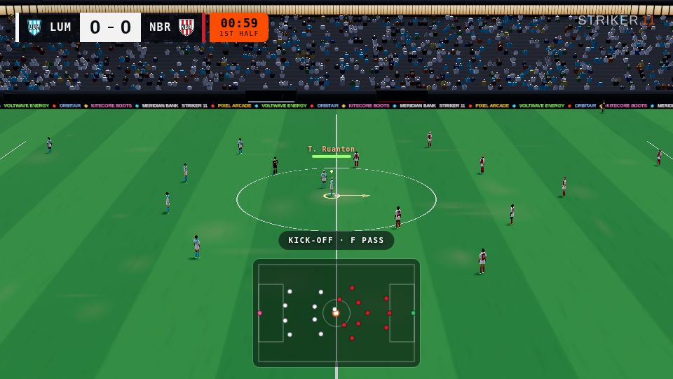

<div align="center">

[](https://normansrule.github.io/pixel-arcade/)

# PIXEL ARCADE.

### 488 original games · 33 full-3D worlds · a 2D + 3D game builder · zero installs

[](https://normansrule.github.io/pixel-arcade/)
[](https://github.com/Normansrule/pixel-arcade/releases)
[](https://normansrule.github.io/pixel-arcade/builder/)


[](https://github.com/Normansrule/pixel-arcade/actions/workflows/test.yml)


**[Play](#-play-in-10-seconds)** · **[3D worlds](#-33-full-3d-worlds)** · **[Cabinets](#-455-arcade-cabinets)** · **[Builder](#-build-your-own)** · **[Get the app](#-play-anywhere)** · **[All games](docs/GAMES.md)**


</div>

---

## ⚡ Play in 10 seconds

1. Open **[normansrule.github.io/pixel-arcade](https://normansrule.github.io/pixel-arcade/)**.
2. Click a cabinet. Press **Space**.
3. Beat the clock. Every game runs against a **round timer**, and the last 10 seconds count down on screen. VS games are decided on points when time runs out.

| | Keyboard | Mouse / touch |
|---|---|---|
| Move | Arrows / WASD | aim games follow the pointer · on-screen D-pad on phones |
| A: fire, jump, select | Space | click, hold, or spam-click |
| B | X | right-click |
| Pause · Restart · Mute · Graphics | P · R · M · G | |
| Exit | Esc | |
| 2 players | P1 WASD + F/G · P2 Arrows + Enter/Shift | |

Can't decide? Hit 🎲 in the top bar. Star ★ the ones you love; they live under **Favorites**.

## 🌍 33 full-3D worlds

Real-time 3D in the browser: shadows, ambient occlusion, bloom, filmic colour, and **G** to switch quality. Every one is an **original game** inspired by a classic; search the hub for the inspiration's name (*gta*, *call of duty*, *tarkov*, *minecraft*, *mario kart*…).


<!-- gen:worlds (generated by tools/gen_docs.py) -->
<table>
<tr>
<td width="33%" align="center"><a href="https://normansrule.github.io/pixel-arcade/ink/"></a><br><b>Gloss Riot</b><br><sub>Splatoon-style</sub></td>
<td width="33%" align="center"><a href="https://normansrule.github.io/pixel-arcade/titans/"></a><br><b>Hardfall</b><br><sub>Titanfall-style</sub></td>
<td width="33%" align="center"><a href="https://normansrule.github.io/pixel-arcade/extract/"></a><br><b>Exfil</b><br><sub>Escape from Tarkov-style</sub></td>
</tr>
<tr>
<td width="33%" align="center"><a href="https://normansrule.github.io/pixel-arcade/parkour/"></a><br><b>Runline</b><br><sub>Mirror's Edge-style</sub></td>
<td width="33%" align="center"><a href="https://normansrule.github.io/pixel-arcade/scope/"></a><br><b>Long Shot</b><br><sub>Sniper Elite-style</sub></td>
<td width="33%" align="center"><a href="https://normansrule.github.io/pixel-arcade/drift/"></a><br><b>Sideways</b><br><sub>Drift Hunters-style</sub></td>
</tr>
<tr>
<td width="33%" align="center"><a href="https://normansrule.github.io/pixel-arcade/arena/"></a><br><b>Nova Arena</b><br><sub>Halo-style</sub></td>
<td width="33%" align="center"><a href="https://normansrule.github.io/pixel-arcade/bow/"></a><br><b>Longbow Keep</b><br><sub>Narrow One-style</sub></td>
<td width="33%" align="center"><a href="https://normansrule.github.io/pixel-arcade/sky/"></a><br><b>Sky Lancers</b><br><sub>War Thunder-style</sub></td>
</tr>
<tr>
<td width="33%" align="center"><a href="https://normansrule.github.io/pixel-arcade/tanks/"></a><br><b>Ironclad</b><br><sub>World of Tanks-style</sub></td>
<td width="33%" align="center"><a href="https://normansrule.github.io/pixel-arcade/zombies/"></a><br><b>Nightfall</b><br><sub>CoD Zombies-style</sub></td>
<td width="33%" align="center"><a href="https://normansrule.github.io/pixel-arcade/city/"></a><br><b>Neon Bay</b><br><sub>GTA-style</sub></td>
</tr>
<tr>
<td width="33%" align="center"><a href="https://normansrule.github.io/pixel-arcade/abyss/"></a><br><b>Abyss Diver</b><br><sub>Subnautica-style</sub></td>
<td width="33%" align="center"><a href="https://normansrule.github.io/pixel-arcade/voxel/"></a><br><b>Voxel Frontier</b><br><sub>Minecraft-style</sub></td>
<td width="33%" align="center"><a href="https://normansrule.github.io/pixel-arcade/suspects/"></a><br><b>Starship Suspects</b><br><sub>Among Us-style</sub></td>
</tr>
<tr>
<td width="33%" align="center"><a href="https://normansrule.github.io/pixel-arcade/brawl/"></a><br><b>Platform Brawl</b><br><sub>Smash Bros-style</sub></td>
<td width="33%" align="center"><a href="https://normansrule.github.io/pixel-arcade/frontline/"></a><br><b>Frontline Ops</b><br><sub>Call of Duty-style</sub></td>
<td width="33%" align="center"><a href="https://normansrule.github.io/pixel-arcade/kart/"></a><br><b>Critter Kart</b><br><sub>Diddy Kong Racing-style</sub></td>
</tr>
<tr>
<td width="33%" align="center"><a href="https://normansrule.github.io/pixel-arcade/strike/"></a><br><b>Strike Zone</b><br><sub>Krunker-style</sub></td>
<td width="33%" align="center"><a href="https://normansrule.github.io/pixel-arcade/rocket/"></a><br><b>Rocket Arena</b><br><sub>Rocket League-style</sub></td>
<td width="33%" align="center"><a href="https://normansrule.github.io/pixel-arcade/gp/"></a><br><b>Kart Grand Prix</b><br><sub>Mario Kart-style</sub></td>
</tr>
<tr>
<td width="33%" align="center"><a href="https://normansrule.github.io/pixel-arcade/siege/"></a><br><b>Fortress Breach</b><br><sub>Rainbow Six Siege-style</sub></td>
<td width="33%" align="center"><a href="https://normansrule.github.io/pixel-arcade/orbit/"></a><br><b>Orbit Lab</b><br><sub>Kerbal Space Program-style</sub></td>
<td width="33%" align="center"><a href="https://normansrule.github.io/pixel-arcade/breach/"></a><br><b>Breach Point</b><br><sub>CS:GO-style</sub></td>
</tr>
<tr>
<td width="33%" align="center"><a href="https://normansrule.github.io/pixel-arcade/monsters/"></a><br><b>Block Beasts</b><br><sub>Pokémon / Pixelmon-style</sub></td>
<td width="33%" align="center"><a href="https://normansrule.github.io/pixel-arcade/skate/"></a><br><b>Skate City</b><br><sub>Tony Hawk-style</sub></td>
<td width="33%" align="center"><a href="https://normansrule.github.io/pixel-arcade/striker/"></a><br><b>Striker 11</b><br><sub>FIFA-style</sub></td>
</tr>
<tr>
<td width="33%" align="center"><a href="https://normansrule.github.io/pixel-arcade/quest/"></a><br><b>Wild Quest</b><br><sub>Zelda: BotW-style</sub></td>
<td width="33%" align="center"><a href="https://normansrule.github.io/pixel-arcade/tumble/"></a><br><b>Tumble Royale</b><br><sub>Fall Guys-style</sub></td>
<td width="33%" align="center"><a href="https://normansrule.github.io/pixel-arcade/royale/"></a><br><b>Storm Royale</b><br><sub>Fortnite-style</sub></td>
</tr>
<tr>
<td width="33%" align="center"><a href="https://normansrule.github.io/pixel-arcade/plaza/"></a><br><b>Penguin Plaza</b><br><sub>Club Penguin-style</sub></td>
<td width="33%" align="center"><a href="https://normansrule.github.io/pixel-arcade/pets/"></a><br><b>Pet Brawl</b><br><sub>Super Auto Pets-style</sub></td>
<td width="33%" align="center"><a href="https://normansrule.github.io/pixel-arcade/drive/"></a><br><b>Night Drive</b><br><sub>Crazy Taxi-style</sub></td>
</tr>
</table>
<!-- /gen:worlds -->

## 🕹️ 455 arcade cabinets


Classic arcade, sports, board games with real CPU search, puzzles, cards, party games and sims, all drawn in HD with particles, shake and juice. VS CPU at three difficulties, or grab a friend for 2-player.

<!-- gen:cats (generated by tools/gen_docs.py) -->
         
<!-- /gen:cats -->

**[See every game →](docs/GAMES.md)**

## 🛠️ Build your own


The **[Game Builder](https://normansrule.github.io/pixel-arcade/builder/)** is a Unity-style editor that runs in your browser, in **2D or 3D**.

- **Start from a template:** platformer, top-down adventure, shooter or maze in 2D; obstacle course, coin island, maze run or arena survival in 3D.
- **Build the scene:** drag in players, enemies, coins, hazards, keys, doors, springs and lights. Move, rotate and scale them with W/E/R gizmos.
- **Add behaviour:** give objects components (patrol, chase, shooter, collectible, hazard…) and wire **WHEN → DO** rules without code.
- **Draw your own art** in a 16×16 sprite painter.
- **Ship it:** press **Play** to test, share a link that opens straight into your game, or **publish** it to the arcade.

## 📲 Play anywhere


| Where | How |
|---|---|
| **Browser** | [normansrule.github.io/pixel-arcade](https://normansrule.github.io/pixel-arcade/): nothing to install. |
| **Install as an app** | Click **⤓ APP** in the top bar (Chrome/Edge/Android), or *Share → Add to Home Screen* on iPhone/iPad. Opens full-screen with its own icon. |
| **Offline** | Click **⤓ Save all offline** at the bottom of the hub; every game is cached and the arcade runs with no internet. |
| **Desktop app** | Installers for **Windows, macOS and Linux** on the [Releases](https://github.com/Normansrule/pixel-arcade/releases) page, built automatically by GitHub Actions. |
| **One file** | `python3 tools/build.py` → `dist/pixel-arcade.html`, the canvas arcade in a single file. |

## 🏆 Scores on GitHub

Click the profile chip and enter your GitHub username. At game over, **U** posts your score as a GitHub issue and **L** opens the global top 10. The 3D worlds have a **POST SCORE** button on their results screens.

## 🧑‍💻 Develop

No build step: the site is static HTML, vanilla JavaScript and ES modules.

```bash
git clone https://github.com/Normansrule/pixel-arcade.git && cd pixel-arcade
python3 -m http.server 8000          # http://localhost:8000
node tests/test.js                   # every canvas game, every mode (shard with RANGE=0:150)
node tests/quality.js                # quality gate → docs/QUALITY.md
python3 tools/gen_docs.py            # counts, README tables, docs/GAMES.md (--art redraws docs/readme/)
python3 tools/build.py               # sw.js + offline.json + dist/pixel-arcade.html
cd desktop && npm install && npm start   # desktop app; npm run dist builds installers
```

Push a tag (`git tag v29 && git push --tags`) and GitHub Actions builds the Windows, macOS and Linux installers onto [Releases](https://github.com/Normansrule/pixel-arcade/releases).

**[Architecture](docs/ARCHITECTURE.md)** · **[Add a game](CONTRIBUTING.md)** · **[Changelog](CHANGELOG.md)** · **[Quality report](docs/QUALITY.md)** · **[Third-party licences](THIRD_PARTY.md)** · MIT licence
